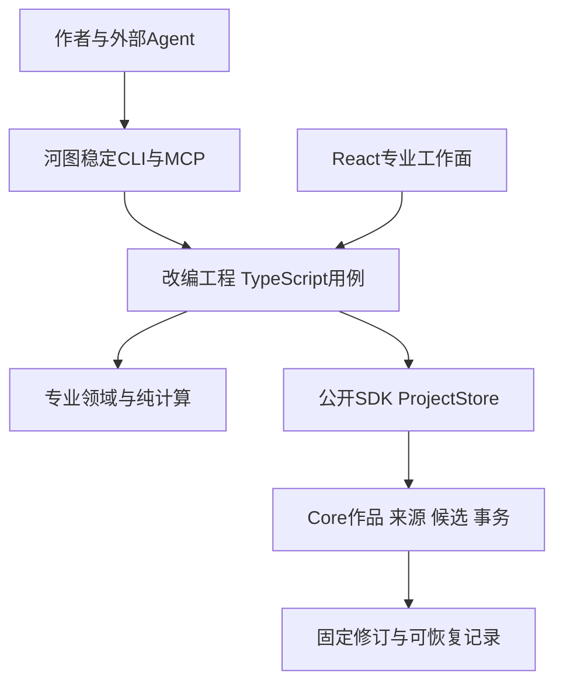
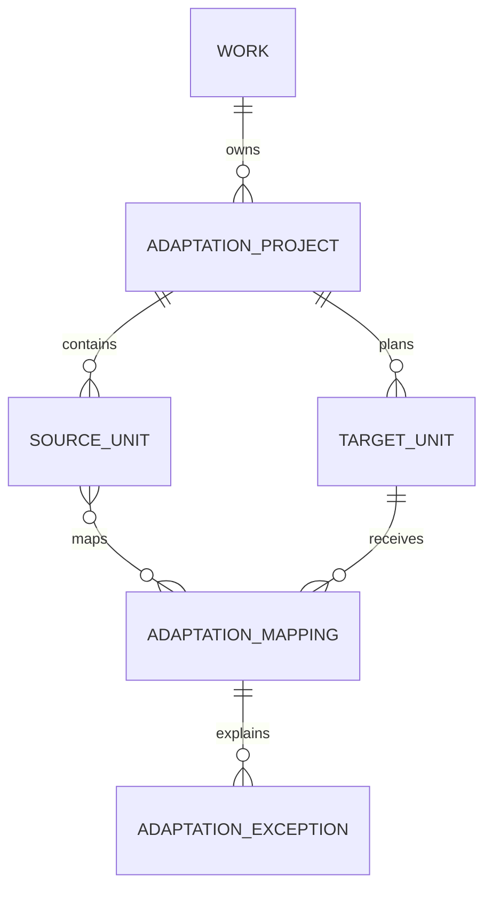

# 架构与领域设计

## 分层与技术选型

TypeScript实现领域不变量与专业用例；React展示审阅面；JSON Schema闭合输入；公开ProjectStore/SDK适配固定来源、CAS和原键。受管Node25执行插件后端，Cordis生命周期由宿主提供，插件不依赖其私有服务。Rust仅负责共享Core，不要求开发Rust扩展。

## 本体与Owner

原著单元、目标段落、改编映射、改编例外属于本插件，来源中的正文、素材和正式设定属于宿主。观察、规划、模拟、实际成果与作者决定分别表达。跨插件依据保存Owner、对象、修订和摘要；不同作品必须分别操作。

## 聚合与持久化

一个专业工程是一个聚合，具有格式版本、标题、专业记录及basis_refs；宿主扩展对象携带WorkRef、Owner、Schema版本和source_refs。保存形成不可变历史修订；不引入第二个数据库。大媒体由素材库持有，工程只保存固定来源索引。

## 关键不变量

原著和改编作品各自拥有正文与设定。插件在当前作品维护专业映射；外部目标仅是固定引用，Agent必须沿目标自己的management_ref核验并创建任务。不得把当前连接当成另一端已获权，不把改编例外写回原著。未知目标修订显示待核验。

遵守KISS与YAGNI：仅实现当前完整旅程所需结构；共享存取由公开SDK承担，专业算法不进入Core。

## 专业实体与关系

| 集合 | 领域角色 | 固定规则 |
| --- | --- | --- |
| units | 原著单元 | 固定选区及read／partial／unread；已读须有逐字依据。 |
| targets | 目标结构 | 媒介、明确顺序、可空时长及外部作品固定引用；引用不授予读取权。 |
| mappings | 改编决策 | 来源单元到目标，preserve／merge／split／omit／add及理由、候选或选定状态。 |
| exceptions | 改编例外 | 关联具体映射或整个工程，解释目标表达的例外，不改原著正典。 |

代码字段与闭合Schema以[manifest](../contracts/plugin-manifest.json)为准；专业引用均属于一个固定工程修订，不跨作品共享写权限。

