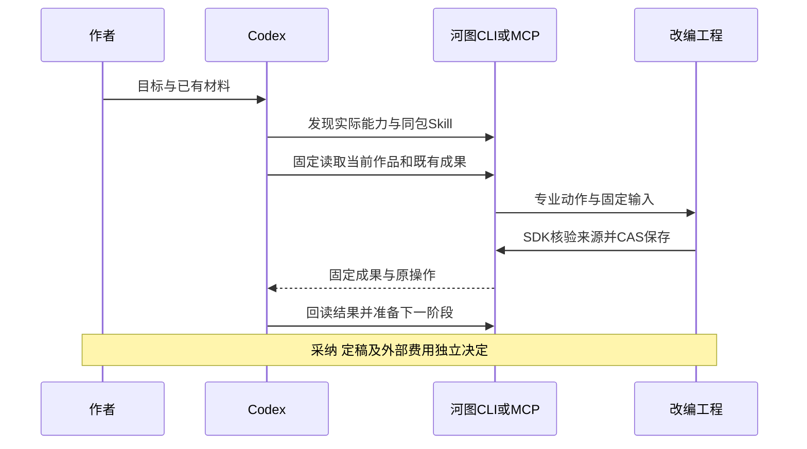

# Skill与机器协作

## 注册与发现

Skill随河图插件manifest声明，通过现有稳定CLI/MCP动态列出和按需读取；没有独立Codex插件、MCP服务或客户端工具名。安装/升级/启停后重新发现包和能力摘要。

## 方法要求

先读现有成果与来源，按实际覆盖组织本次目标；完成复盘固定原著→划分来源单元→组织目标分集→比较删并拆增→准备目标候选→原著更新影响→局部返工。动作参数以发现Schema为准，方法不赋予额外权限。跨作品Agent分别读取，专业插件不得合并management_ref。

原著和改编作品各自拥有正文与设定。插件在当前作品维护专业映射；外部目标仅是固定引用，Agent必须沿目标自己的management_ref核验并创建任务。不得把当前连接当成另一端已获权，不把改编例外写回原著。未知目标修订显示待核验。

包内SKILL保持简洁，operations导航实际动作，workflows承接专业正反例；测试需要当前Codex连接真的读取方法并完成至少一次专业动作。
